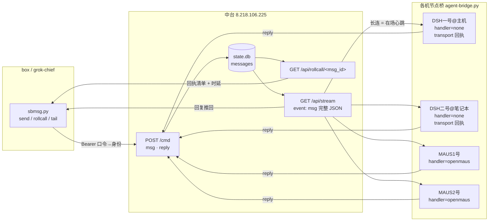
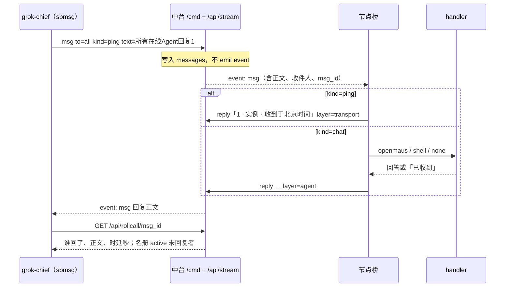

# 实时消息总线 v1

> 2026-11-10：把「心跳监测」升级为 Agent 之间经中台的实时双向通道。
> 大古要的是：主机上的 DSH1 号和笔记本上的 DSH2 号通过服务器上的中台互相收发；
> grok-chief 说一句就能调度所有在线 Agent，它们的回复实时回到中台再到 grok-chief。
>
> 配套代码：`90-System/runtime/message_bus.py`、`/cmd` 的 `msg`/`reply`、
> `/api/stream` 的 `event: msg`、`tools/bus/` 下的节点桥与 box 客户端。

## 为什么不走原来的 /cmd submit

2026-11-10 20:16（北京时间）用 `submit` 广播「所有在线 Agent 回复 1」（`evt_20261110_ce038c`）时，只有服务器上的 `chat-worker`（LLM）约 11 秒后代答，写入了 `60-Outputs/chat/...通道验证回复.md`。dsh-chief、dsh2-chief、maus2-chief 等真 Agent 没有任何回复。

根因有两层：

1. `/api/stream` 原先只推事件**元数据**（id / type / status，无正文、无收件人）。各机 courier 收到后全部丢弃（`for _ in r: pass`），长连只用来续心跳。
2. 没有「回复」接口。`submit` 会进 `events` 路由，被规则派给 `chat-worker`，于是看起来像「有人回了」，其实是中台自己的 LLM 在代答。效率低，而且 Agent 不能自主回传。

消息总线把「说话」从任务路由里拆出来：消息只进 `messages` 表，**不进 events，不触发任何 LLM worker**。

## 架构





## 协议

身份一律由口令映射到 chief，**不能在 args 里伪造 `from`**。可选 `instance` 必须是该 chief 名下、名册 `active` 的实例。

### POST /cmd  `msg`

```json
{"cmd":"msg","args":{"to":"all","text":"所有在线 Agent 回复 1","kind":"ping","instance":"可选"}}
```

| 字段 | 说明 |
|---|---|
| `to` | `"all"` 广播，或 `agent_id`（如 `dsh2-chief`），或实例名（如 `DSH二号@笔记本`） |
| `text` | 正文，必填 |
| `kind` | 默认 `chat`；点名用 `ping`；另允许 `ack` |
| `reply_to` | 可选，挂到已有消息 |
| `instance` | 可选，声明本侧实例 |

返回 `msg_id`、`thread_id`、`created_at`。广播不会经 SSE 回推给发件人自己。

### POST /cmd  `reply`

```json
{"cmd":"reply","args":{"reply_to":"msg_20261110_ab12cd","text":"1 · DSH二号@笔记本 · 收到于…","instance":"DSH二号@笔记本"}}
```

等价于 `msg` 且 `to` 自动设为原发件人。

### GET /api/stream（在原有 `event: event` 之外）

每轮另查 `messages`：`created_at >= since` 且（`to='all'` 或 `to=该连接的 agent_ref` 或 `to=实例名`），以：

```
event: msg
data: {"msg_id","from_agent","from_instance","to","kind","text","reply_to","thread_id","created_at"}
```

推送**完整 JSON（含正文）**。连接身份由口令→chief 映射；无 `instance` 的连接也能收发给其 chief 的消息。`?instance=` 仍然表示在场，语义与原来的心跳一致。

事件流与消息流使用**各自的 since 游标**，互不推移，避免漏消息。

### 只读查询

- `GET /api/messages?thread=&since=&to=&limit=`
- `GET /api/rollcall/<msg_id>`：该点名的回复清单（谁回、正文、时延秒），以及名册里 `active` 但未回复的 agent（附带是否在场，便于区分「没在线」和「在线却没回」）。

### 表结构（启动时幂等建表）

`messages(msg_id, from_agent, from_instance, to, kind, text, reply_to, thread_id, created_at)`

## 节点桥与 box 客户端

- 节点：`tools/bus/agent-bridge.py`，读同目录 JSON。SSE 长连（带 instance），断线指数退避重连。本地 `bridge.log` 不写口令。
- 点名（`kind=ping`）：立即自动 reply `1 · <instance> · 收到于<北京时间>`，标明 `layer=transport`（传输层确认）。
- 对话（`kind=chat`）：交给 handler，结果 reply 并标明 `layer=agent`；超过 120 秒回复超时说明。
  - `openmaus`：优先 `POST http://127.0.0.1:8799/api/bots/<bot_id>/messages`，失败或 `mode=cli` 时再跑 `openmausbot run <bot> "<text>"`。启动时会探 8799 的实际返回，按 `reply` / `text` / `message` / `content` / `choices` 等字段兼容抽取。
  - `shell`：运行配置里的命令，正文经 stdin 传入，取 stdout。
  - `none`：只回执「已收到」。
- box：`tools/bus/sbmsg.py`
  - `send --to all --kind ping "text"`
  - `rollcall <msg_id>`
  - `tail`（订阅打印发给口令对应 chief，默认 grok-chief 的消息）
- Windows 安装与计划任务看门狗：`tools/bus/INSTALL-Windows.md`、`watchdog.ps1`。
- Linux / box：`tools/bus/super-brain-bridge.service`。

## 谁用什么 handler（现状务必写清）

| 身份 | 建议 handler | 现状 |
|---|---|---|
| MAUS1 号 / `maus-chief` | `openmaus` | 本机 8799 或 `openmausbot` 可直接给出 agent 层回答 |
| MAUS2 号 / `maus2-chief` | `openmaus` | 同上 |
| DSH一号 / `dsh-chief` | `none` | DSH 是 Grok Bot。本地桥**先做 transport 层回执**（点名回 `1`）。agent 层回复后续经 Grok Bot 的 webhook 唤醒，或由 grok-chief 转达，本 v1 **尚未打通** |
| DSH二号 / `dsh2-chief` | `none` | 同上 |
| grok-chief | 不必挂桥 | 用 `sbmsg.py` 发送、订阅、查点名 |

旧的 `tools/duty-room/*-courier.py` 仍只负责任务队列 / 在场心跳，**不会**把 `event: msg` 当成任务去跑 LLM；消息通道以本桥为准。两套可以暂时并存：courier 继续心跳与队列，bridge 负责实时对话。后续可考虑合并，但不在 v1 范围。

## 三层验收

指挥「所有在线 Agent 回复 1」之前，按这三层看，不要再被「进程在、心跳在、但其实收不到正文」骗到。

| 层 | 含义 | 怎么验 |
|---|---|---|
| 1. 进程在跑 | 节点桥 / 中台进程活着 | Windows：任务管理器或看门狗日志里有 pid；Linux：`systemctl status super-brain` 与 `super-brain-bridge` |
| 2. 在场 | SSE 已连上，名册显示在线 | 桥日志有「SSE 已建立（在场心跳中）」；`GET /api/agents` 里对应 chief 的 `live_status` 为 `idle` / `working`，且 `presence_via` 能追溯到实例心跳 |
| 3. 能收发并回复 | 点名到达、回执回到中台 | `sbmsg.py send --to all --kind ping "所有在线 Agent 回复 1"`，再 `rollcall <msg_id>`：应列出各实例的 `layer=transport` 回执和时延秒；在场却未出现在回复里，就是第 3 层失败 |

本地不依赖线上服务器即可验收：`python3 tools/bus/selftest.py`（点名 → 三个模拟节点回复 → rollcall 显示时延，并断言未写入 events）。

## 部署（本 PR 只交代码，不直接上生产）

见本 PR 说明中的步骤清单：备份 `state.db` → `git pull` → `systemctl restart super-brain` → 用 `healthz` / `msg` / `rollcall` 验证。口令文件与环境变量保持原样，不要写进仓库。
